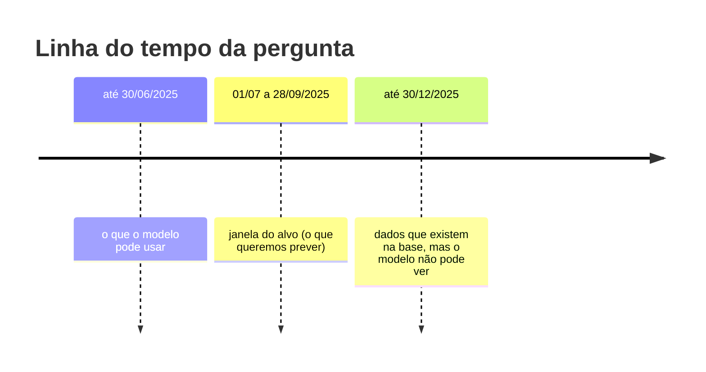
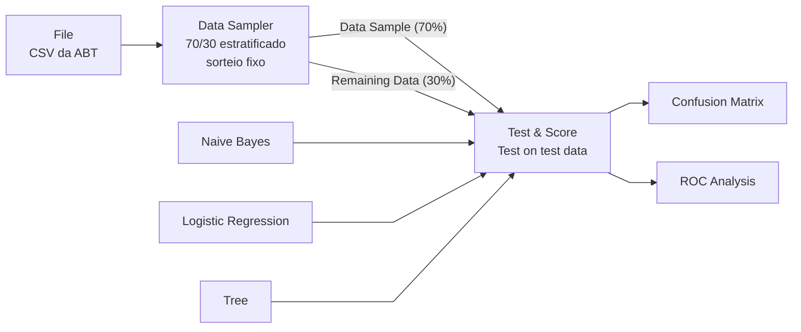
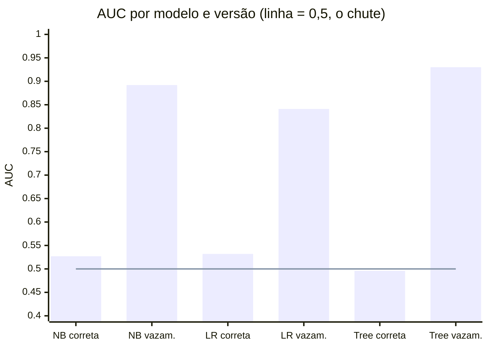

# Relatório de resultados · experimento de vazamento

**Equipe:** Diogo Augusto de Siqueira Cândido, Líbia Canhete Alves e Cruz, Lucas Taveira De Lima
**Data:** 31/10/2026

**Pergunta do projeto:** dado o comportamento de compra do cliente até
30/06/2025, ele fará ao menos uma nova compra entre 01/07 e 28/09/2025?

## Resumo

| Pergunta do guia | Resposta curta |
|---|---|
| a) Diferença entre as versões | O vazamento sobe a AUC de cerca de 0,53 para até 0,93. A versão correta fica perto do chute. |
| b) O vazamento sutil fez diferença? | Não. O resultado ficou igual até a 4ª casa decimal. |
| c) Como descobrir o vazamento sem ver o código? | Testar cada coluna sozinha e conferir se os valores fazem sentido. A recência negativa em 40% dos clientes denuncia o erro. |

## Como medimos

### As duas tabelas

As duas ABTs têm os mesmos 107.642 clientes, o mesmo alvo (22,3% recompraram)
e as mesmas três colunas. Só muda de onde vêm os números.



| Coluna | Versão correta (RDT-14) | Versão com vazamento (RDT-15) |
|---|---|---|
| `frequencia_pedidos` | pedidos até o corte | todos os pedidos, até 30/12/2025 |
| `recencia_dias` | dias entre a última compra e o corte | conta compras depois do corte e fica negativa |
| `valor_monetario` | valor em reais até o corte | z-score com média e desvio de todas as linhas, antes da partição |

### O fluxo no Orange

Os arquivos `orange/fluxo_correta.ows` e `orange/fluxo_vazamento.ows` só
diferem no CSV de entrada.



* Modelos com as configurações padrão do Orange 3.40.
* O exportador ordena as linhas por `cliente_sk`. Com o sorteio fixo, as duas
  versões usam os mesmos clientes: 75.350 no treino e 32.292 no teste, com
  7.206 positivos no teste.
* O Test & Score não mostra a acurácia balanceada (a média entre o acerto dos
  positivos e o dos negativos). O `orange/experimento.py` refaz o fluxo com os
  mesmos widgets e o mesmo sorteio e calcula essa métrica. Carregamos os
  `.ows` no motor do Orange, e as AUCs batem com as do script até a 4ª casa.

## a) Diferença de desempenho entre as duas versões

| Modelo | AUC correta | AUC vazamento | Diferença | Acur. bal. correta | Acur. bal. vazamento | Diferença |
|---|---:|---:|---:|---:|---:|---:|
| Naive Bayes | 0,527 | 0,892 | +0,365 | 0,500 | 0,749 | +0,249 |
| Logistic Regression | 0,532 | 0,841 | +0,309 | 0,500 | 0,598 | +0,098 |
| Tree | 0,496 | 0,930 | +0,434 | 0,496 | 0,908 | +0,412 |



### Matrizes de confusão no teste

Classe 1 = recomprou. Cada célula é o número de clientes.

| Modelo | Versão | VP | FP | FN | VN |
|---|---|---:|---:|---:|---:|
| Naive Bayes | correta | 0 | 0 | 7.206 | 25.086 |
| Naive Bayes | vazamento | 4.603 | 3.509 | 2.603 | 21.577 |
| Logistic Regression | correta | 0 | 1 | 7.206 | 25.085 |
| Logistic Regression | vazamento | 2.093 | 2.361 | 5.113 | 22.725 |
| Tree | correta | 1.227 | 4.474 | 5.979 | 20.612 |
| Tree | vazamento | 6.111 | 809 | 1.095 | 24.277 |

VP: previu "recompra" e recomprou. FP: previu "recompra" e não recomprou.
FN: previu "não recompra" e recomprou. VN: previu "não recompra" e não
recomprou.

### O que os números mostram

* Com vazamento, a AUC sobe entre 0,31 e 0,43, e a árvore acerta 94,1% dos
  clientes.
* Na versão correta, Naive Bayes e Regressão Logística preveem "não
  recompra" para quase todo mundo. Com 22% de positivos e atributos fracos,
  apostar na maioria é o que mais acerta, e a acurácia balanceada fica em
  0,500.
* A árvore da versão correta cresce até 30.473 nós decorando ruído do treino e fica
  abaixo do acaso no teste (AUC 0,496).
* A acurácia simples (CA) chega a 77,7% na versão correta só porque o modelo
  responde "não" para quase todos.

### Por que a versão correta é tão fraca

O gerador sorteia o cliente e a data de cada pedido de forma independente
(`gerador/gerar_dados.py`, linhas 283-284 e 394-395). Assim, o histórico do
cliente quase não informa a próxima compra.

* O melhor atributo legítimo que encontramos tem AUC 0,55 sozinho.
* Quatro atributos extras levaram o modelo a 0,549 no máximo (RDT-14).

A versão correta, com 0,53, responde à pergunta com os dados que existiriam em
30/06/2025. O 0,93 da outra versão só aparece porque ela usa compras que
ainda não tinham acontecido.

## b) O vazamento sutil fez diferença?

Não, a diferença foi zero. Para isolar o efeito, pegamos a versão correta e
normalizamos `valor_monetario` de três formas:

| Normalização de `valor_monetario` | AUC NB | AUC LR | AUC Tree | Acur. bal. Tree |
|---|---:|---:|---:|---:|
| nenhuma | 0,5270 | 0,5318 | 0,4955 | 0,4960 |
| z-score com média e desvio do treino (correto) | 0,5270 | 0,5318 | 0,4955 | 0,4960 |
| z-score com média e desvio da base inteira (vazamento) | 0,5270 | 0,5318 | 0,4955 | 0,4960 |

As matrizes de confusão também saem idênticas.

### Por que não mudou

| Motivo | Detalhe |
|---|---|
| A informação que vaza é pequena | Base inteira: média 6.924,10 e desvio 5.115,01. Só treino: média 6.947,10 e desvio 5.115,48. Os 30% de teste mexem a média em 0,3%. |
| O z-score não muda a ordem dos valores | A árvore corta por limiares e o Naive Bayes do Orange discretiza os atributos numéricos. Os dois dão o mesmo resultado em qualquer escala. |
| A Regressão Logística depende pouco da escala | Ela depende da escala só pela regularização, e com 75 mil linhas de treino esse efeito some. |

### Por que continua sendo um erro

O treino usou informação do teste. Aqui o efeito foi zero, mas o mesmo erro
muda o resultado quando:

* o pré-processamento aprende algo ligado ao alvo usando a base inteira, como
  preencher vazios pela média da classe, selecionar atributos ou codificar
  categorias pela taxa do alvo;
* a base é pequena e o teste pesa mais na média.

Como o número não muda, só a revisão do código encontra esse erro.

## c) Como descobrir o vazamento recebendo só o resultado

Faríamos estas verificações, da mais barata para a mais cara:

| Passo | O que fazer | O que aparece nesta base |
|---|---|---|
| 1. Comparar com o que o problema permite | Perguntar se a AUC faz sentido para três colunas de histórico | A frequência até o corte, o atributo mais óbvio, dá 0,531 sozinha. A árvore com vazamento passa disso por 0,40. Um salto desse tamanho pede auditoria. |
| 2. Medir cada coluna sozinha | Calcular a AUC de cada atributo isolado | Com vazamento: recência 0,797 e frequência 0,706. Na correta: 0,510 e 0,531. Uma coluna que quase resolve o problema sozinha costuma carregar o alvo. |
| 3. Olhar o domínio dos valores | Conferir mínimos, máximos e sinais | "Dias desde a última compra" não pode ser negativo, e é negativo em 43.150 clientes (40,1%). Nenhum cliente com recência ≥ 0 recomprou, uma regra exata demais para comportamento de compra. |
| 4. Ler o modelo | Ver a primeira divisão da árvore | A raiz corta em `recencia_dias ≤ -1`, um limiar que só faz sentido para quem sabe que o cliente comprou depois. A árvore com vazamento tem 5.491 nós; a correta, 30.473. |
| 5. Conferir a origem de cada coluna | Recalcular cada atributo só com dados até o corte e comparar | A asserção `frequência/recência enxergam o futuro` encontra 43.150 clientes diferentes. Na versão correta, `atributos conferidos sem dados futuros` dá zero. |
| 6. Simular o dia da previsão | Rodar a mesma consulta numa cópia da base parada em 30/06/2025 | Sem os pedidos de julho a dezembro, a consulta sem filtro devolve os mesmos valores da versão correta, e o desempenho cai para cerca de 0,53. |

O passo 5 já está no pipeline como asserção e impede que o erro volte.

## Reproduzir

```bash
docker compose exec etl python 04_abt.py --correta
docker compose exec etl python 04_abt.py --vazamento
docker compose exec etl python 05_exportar_orange.py
python orange/experimento.py
```

* O último comando roda fora do contêiner, no ambiente com o Orange descrito
  no README. Ele grava os dois `.ows` e imprime as tabelas deste relatório.
* Para abrir os fluxos no Orange, use **File → Open** em `orange/`. O widget
  File encontra o CSV em `../saida/` pelo caminho relativo.
